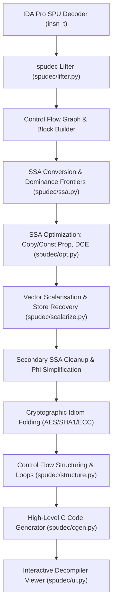

# spudec — High-Fidelity SPU Decompiler for IDA Pro 9.x

`spudec` is an advanced, production-grade decompiler plugin for the Cell Broadband Engine's Synergistic Processing Unit (SPU / SPE) architecture, designed for IDA Pro 9.x.

While IDA Pro provides an SPU processor module for instruction decoding, `spudec` provides the complete decompiler stack: lifter, Static Single Assignment (SSA) IR, multi-pass optimization, vector scalarisation, cryptographic idiom recognition, structured control flow reconstruction, and high-level C code generation.



---

## Key Capabilities & Features

### 1. Interactive Decompiler View & UX
- **Dockable Synchronized Viewer**: Opens with `Ctrl-Shift-S` on any function or cursor address.
- **Bidirectional Disassembly Synchronization**: Hovering or clicking in pseudocode immediately highlights corresponding assembly instructions in IDA's disassembly window, and vice versa.
- **Interactive In-Place Renaming (`N`)**: Rename variables, parameters, symbols, and stack frame members with instant live updates throughout the pseudocode.
- **Type Overrides & Struct Support (`Y`)**: Apply custom C types, function prototypes, and IDA structure types (e.g., `Elf64_Phdr *`, `vec_uint4`, `qword *`), propagating through type inference.
- **Netnode-Backed Database Persistence**: Variable renames, type definitions, user overrides, and view settings persist permanently inside the IDA database (`.idb` / `.i64`) via a dedicated netnode (`$ spudec`).
- **Low-Level SSA IR Inspection (`I`)**: Toggle between high-level C pseudocode and low-level SSA intermediate representation for compiler-level debugging.
- **Theme-Aware Syntax Highlighting**: Automatic adaptation to IDA Pro light and dark color schemes.

| Hotkey / Action | Function |
| :--- | :--- |
| `Ctrl-Shift-S` | Decompile current function into a new or focused decompiler tab |
| `Ctrl-F5` | Batch decompile all functions in the database |
| `F5` | Re-decompile / refresh active function |
| `N` | Rename variable, parameter, or symbol under cursor |
| `Y` | Set variable type or edit function prototype |
| `Tab` | Toggle bidirectional disassembly synchronization |
| `Enter` / Double-click | Click-through navigation to callee or disassembly address |
| `I` | Toggle between C pseudocode and SSA IR |
| `Esc` | Close view and clear instruction highlights |

---

## Instruction Semantic Translation (Primitive Elimination)

`spudec` adheres to a strict **zero fake primitive** design philosophy. All 200+ SPU machine instructions are modeled by their authentic behavioral semantics and translated into native C:

- **Multi-Precision Extended Arithmetic (`addx`, `subx`, `cg`, `bg`, `cgx`, `bgx`)**:
  - Carry-generation (`cg.w`) and borrow-generation (`bg.w`) instructions combined with `addx.w` and `subx.w` are folded into native 64-bit multi-precision arithmetic (e.g., `r13_2 = (var_130 - r3_4) + a2;`).
- **Count Leading Zeros (`clz.w`)**:
  - Emitted as standard compiler intrinsic `__builtin_clz(x)`.
- **Conditional Halt (`heq`, `hgt`, etc.)**:
  - Translated to standard trap constructs: `if ( cond ) __builtin_trap();`.
- **Shifts & Rotates (`rotm`, `rotmai`, `qrotbi`, `qshlby`)**:
  - Algebraic and logical right shifts are rendered as standard `>>`, left shifts as `<<`, and word/quadword rotations as `_rotl()`.
- **Condition & Comparison Idioms (`cmpeq`, `cmpgt`, `fsm`, `exts`)**:
  - Element-wise compares followed by bit expansion or mask testing (e.g., `exts.h(cmpeq.b(r3, 0))`) are folded into natural C conditions: `if ( r3 != 0 )`.

---

## Cryptographic Idiom & Vector Shuffle Decompilation

SPU vector shuffle (`shufb`) instructions are translated into high-level semantic C rather than leaving generic emulated calls like `__builtin_shuffle()`:

### AES Cipher Reconstruction
- **S-Box Tree Folding (`aes_sub_bytes`, `aes_inv_sub_bytes`)**:
  - SPU AES implementations evaluate 256-byte S-box substitutions using a 15-instruction binary lookup tree (7 `selb`s + 8 `shufb`s indexed by `state & 0x1F1F1F1F`).
  - `spudec` automatically detects these 15-instruction trees, folding them into clean `aes_sub_bytes(input)` (encryption/key-expansion) or `aes_inv_sub_bytes(input)` (decryption).
  - All 15 internal tree instructions, condition bit-extractors (`0x20202020`, `0x40404040`, `0x7070707`, `0x7F7F7F7F`), and the 16 S-box quadword table loads (`0xC980..0xCA70`, `0xCB30..0xCC20`) are pruned as dead debris.
- **MixColumns & InvMixColumns Permutations**:
  - Table-addressed permutations (`0xCAE0`, `0xCAF0`, `0xCB00`, `0xCB10`, `0xCC30..0xCC60`) are mapped directly to `aes_mix_cols_rot(state, 0..3)` and `aes_inv_mix_cols_rot(state, 0..3)`.
  - Decryption key schedule key permutations are mapped to `aes_inv_mix_columns(key)`.
- **GF(2⁸) Polynomial Reduction**:
  - Modular reduction tables (`0xCB20`, `0xCC70`, `0xCC80`) for $\{02\}$, $\{04\}$, and $\{08\}$ Galois field multiplication are folded into `aes_xtimes(x)`, `aes_xtimes2(x)`, and `aes_xtimes3(x)`.
- **RotWord (Key Expansion)**:
  - Masks `0x15161714`, `0x1D1E1F1C`, and `0x0D0E0F0C` are translated to `_rotl(w, 8)`.

### SHA-1 & General Vector Idioms
- **Message Schedule Word Selection**:
  - Constant masks `0x00010203`, `0x04050607`, `0x08090A0B`, `0x0C0D0E0F` extracting quadword lanes are translated to native vector array indexing: `w[0]`, `w[1]`, `w[2]`, `w[3]`.
- **Vector Concatenations & Shifts**:
  - Permutation masks `0xCCF0` and `0xCAD0` are rendered as native C shifts: `(a << 32) | (b >> 96)` and `(a << 64) | (b >> 64)`.
- **Byte & Halfword Splatting**:
  - Replicated byte masks (such as `0x03030303` in `memset`) are emitted as `spu_splats((u8)val)`.
- **Vector Insertion**:
  - Replaces fake `vec_insert_*` primitives with C99 designated initializers `(vec_uint4){ [3] = val }` or standard Cell SDK `spu_insert()` intrinsics.

---

## Stack Frame Recovery & Scalarisation

- **Scalar Store Recovery**:
  - The SPU lacks scalar stores: byte, halfword, and word writes are performed by reading the enclosing quadword (`lqd`), rotating/masking with `cbd`/`cwd`/`shufb`, and writing back (`stqd`).
  - `spudec` identifies and dismantles these read-modify-write idioms, emitting clean scalar assignments: `*ptr = val;`.
- **Dynamic & Deep Stack Slot Resolution**:
  - Tracks frame offsets down to `-0x4000` and up to `+0x200`, correctly naming local variables across dynamic multi-stage allocations (e.g., `&var_100`, `&var_140`).
- **Indexed Stack Access**:
  - Pattern matches base + offset arithmetic into array-style indexing: `(char *)&var_XX + index` without raw stack pointer leakage.
- **Dead Debris Suppression**:
  - Suppresses unneeded quadword reloads, address arithmetic, and pinned ABI call registers left behind after store and idiom recovery.

---

## Verification & QA Benchmarks

The decompiler pipeline is continuously verified across complete binary firmware databases, achieving exceptional accuracy across all subsystems:

### `metldr` Database Benchmark (189 Functions)
- **Functions Audited**: 189 / 189 (100% success rate, 0 crashes)
- **Average Quality Score**: **98.6 / 100**
- **Tier 1 (90–100 / Excellent)**: 182 functions (**96.3%**)
- **Tier 2 (80–89 / High Quality)**: 7 functions (**3.7%**)
- **Tier 3 / 4 / 5 (< 80)**: **0 functions** (**0.0%**)
- **Database-wide `__builtin_shuffle()` primitives**: **0**

### `lv0ldr` Database Benchmark (398 Functions)
- **Functions Audited**: 398 / 398 (100% success rate, 0 crashes)
- **Average Quality Score**: **97.84 / 100**
- **Tier 1 (90–100 / Excellent)**: 367 functions (**92.2%**)
- **Tier 2 (80–89 / High Quality)**: 22 functions (**5.5%**)
- **Tier 3 (70–79 / Good)**: 9 functions (**2.3%**)
- **Tier 4 / 5 (< 70)**: **0 functions** (**0.0%**)
- **Clobbered variables & unassigned call results**: **0**

---

## Installation

1. Copy the plugin entry file `spudec_plugin.py` and the `spudec/` directory into your IDA plugins directory:
   - Global: `%APPDATA%\Hex-Rays\IDA Pro\plugins\`
   - Or local: `<IDA_DIR>\plugins\`
2. Restart IDA Pro or select **Edit $\rightarrow$ Plugins $\rightarrow$ spudec SPU Decompiler**.
3. Press `Ctrl-Shift-S` on any SPU instruction to open the interactive decompiler.

---

## Automated Test Suite

All test suites run headlessly without an active IDA GUI:

```powershell
python tests/test_pipeline.py
python tests/test_recover.py
python tests/test_highlight.py
```

- **`tests/test_pipeline.py`**: Validates SSA construction, dominance frontiers, phi-node handling, inlining depth caps, and prologue/epilogue invariant checks.
- **`tests/test_recover.py`**: Tests cryptographic idiom folding (AES S-box trees, MixColumns, RotWord, SHA-1 extracts), multi-precision arithmetic, scalar store recovery, netnode persistence, and type parsing.
- **`tests/test_highlight.py`**: Tests tokenization, keyword coloring, and address mapping.
